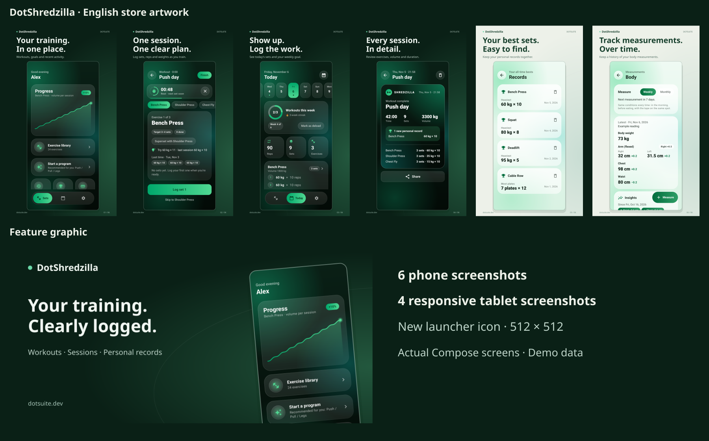

# DotShredzilla 🦖🏋️

> Log your workouts, follow guided sessions and keep your training history, personal records and body measurements together.

[](https://android.com)
[](https://kotlinlang.org)
[](https://developer.android.com/jetpack/compose)
[](https://firebase.google.com)
[](LICENSE)

---

## Current release

**1.5.1 (version code 9)** — targets API 37 and supports Android 10 / API 29+.
This update replaces broad gallery access with the Android system photo picker
and corrects the registration links to the app-specific legal pages.

- [Google Play](https://play.google.com/store/apps/details?id=com.FreeRave.shredzilla)
- [DotSuite](https://dotsuite.dev)
- [Terms of use](https://dotsuite.dev/en/dotshredzilla/terms)
- [Privacy policy](https://dotsuite.dev/en/privacy#dotshredzilla)
- [Account and data deletion](https://dotsuite.dev/en/privacy#delete-dotshredzilla)
- Support: [support@dotsuite.dev](mailto:support@dotsuite.dev)

The legal pages support English, Arabic, German, French and Russian. Canonical
terms are in [docs/legal](docs/legal/README.md). Native UI labels remain English.

## Store listing

English descriptions, six phone screenshots, four tablet screenshots
and a feature graphic in English are in [fastlane/metadata/android](fastlane/metadata/android).
The [artwork guide](marketing/google-play/README.md) explains the isolated demo
capture and reproducible rendering workflow. Native app labels are in English.



## Overview

DotShredzilla is an Android workout tracker built with Kotlin and Jetpack Compose.
Record your sets, follow a guided workout, and review session history, personal
records and body measurements. Sets can be logged offline and synchronized with
Firestore when a connection returns.

## Features

- **Workout logging:** reps, kg/lb, plate counts, bodyweight and per-side loads;
  warm-up, drop, rest-pause and failure sets, plus tempo and notes.
- **Guided sessions:** custom exercise lists, ready-made programs, targets,
  previous-session details, supersets and a rest timer.
- **History and records:** session summaries, duration, volume, personal records,
  charts and shareable workout summaries.
- **Consistency:** weekly workout goals, activity history and deload reminders.
- **Body measurements:** weight, measurements, left/right entries and trends.
- **Account controls:** Google or email/password sign-in, cloud synchronization,
  and deletion of the account and associated data from Settings.
- **Appearance:** light and dark themes, with native English UI labels.

Training suggestions are general fitness guidance, not medical advice. The app
contains advertising. See the linked privacy policy for data practices and
account deletion details.

---

## Tech Stack

| Layer | Technology |
|---|---|
| Language | Kotlin |
| UI Framework | Jetpack Compose (Material 3) |
| Architecture | MVVM + State Hoisting |
| Backend | Firebase Authentication + Cloud Firestore |
| Async | Kotlin Coroutines + StateFlow |
| Ads | Google AdMob (App Open Ads + Rewarded Ads) |
| Notifications | NotificationCompat (Rest Timer) |
| Image Handling | Internal Storage + FileProvider |

---

## Getting Started

### Prerequisites
- Android Studio (latest stable)
- Android device or emulator running API 29+
- A Firebase project

### Setup

1. **Clone the repository:**
   ```bash
   git clone https://github.com/kareem2099/Shredzilla.git
   cd Shredzilla
   ```

2. **Configure Firebase:**
   - Create a new project at [console.firebase.google.com](https://console.firebase.google.com)
   - Register an Android app using the package name `com.FreeRave.shredzilla`
   - Download `google-services.json` and place it in the `app/` directory
   - Enable **Cloud Firestore** and **Authentication** (Email/Password + Google providers)

3. **Configure signing (for Release builds):**
   Add the following to your `gradle.properties` (this file is `.gitignored` and never committed):
   ```properties
   SHREDZILLA_RELEASE_STORE_FILE=your_keystore.jks
   SHREDZILLA_RELEASE_STORE_PASSWORD=your_store_password
   SHREDZILLA_RELEASE_KEY_ALIAS=your_key_alias
   SHREDZILLA_RELEASE_KEY_PASSWORD=your_key_password
   ```

4. **Build & Run:**
   - Open the project in Android Studio
   - Sync Gradle
   - Run on a device or emulator

---

## Roadmap

### v1.3.0 — Modernized Authentication & UX Polish *(Previous milestone)*
- [x] Revamped auth screens (Login & Register) with custom vertical gradients and brand assets
- [x] Fully compliant Google Sign-in buttons (official branding specs)
- [x] Input focus chaining via FocusRequesters & keyboard Done actions
- [x] Single-source-of-truth email format & field validation logic
- [x] Loading state lockouts to prevent double-submissions
- [x] Integrated Forgot Password flow with inline animated success confirmation
- [ ] Real workout activity indicators on the day strip
- [ ] Per-exercise chart selector
- [ ] LazyColumn pagination for large exercise lists
- [ ] Screen transition animations
- [ ] Analytics cache via `SavedStateHandle`

### v1.2.0 — Core Workflow Stability
- [x] Offline-First Optimistic UI for set logging
- [x] Zero-Drift delta-math rest timer
- [x] Debounced exercise search with ViewModel StateFlow
- [x] Historical analytics with dynamic progress chart
- [x] Date-selectable Today screen

---

## Contributing

Contributions, issues, and feature requests are welcome.

1. Fork the repository
2. Create a feature branch (`git checkout -b feature/your-feature`)
3. Commit your changes (`git commit -m 'Add your feature'`)
4. Push to the branch (`git push origin feature/your-feature`)
5. Open a Pull Request

Please ensure your code follows the existing architecture patterns (MVVM, State Hoisting, ViewModel-owned coroutines) before submitting.

---

## Security

This repository does **not** contain:
- `google-services.json`
- `gradle.properties` (signing credentials)
- Any `.keystore` or `.jks` files

If you discover a security vulnerability, please open a private issue rather than a public one.

---

## License

This project is licensed under the Apache License 2.0 — see the [LICENSE](LICENSE) and [NOTICE](NOTICE) files for details.